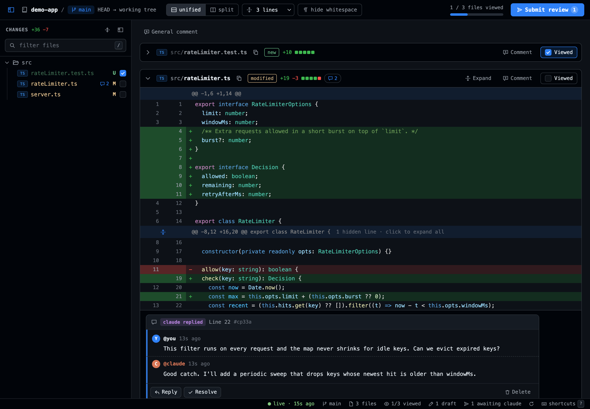

# lcr: local code review

A GitHub-style review UI for your local, **uncommitted** changes. Review your work like a PR before you push, and optionally send your comments straight to Claude Code to fix.



## Project status

I built lcr because I wanted to review my local changes the way I review a PR on GitHub, before pushing anything, and couldn't find a tool that did that. The first version was written quickly with AI assistance to prove the idea: it works, but parts of the code haven't had careful human review yet.

From here on, development is deliberate: changes go through PRs with review and tests. Issues, feedback and contributions (including cleanups of the existing code) are very welcome.

- **Submit to Claude**: batch your comments and send them with one click, straight into the tmux pane running Claude Code (auto-detected), to the clipboard, or into a queue Claude pulls with `lcr feedback`.
- **Live**: the diff updates as files change. "Viewed" is tied to the file's changes, so a file you already viewed is un-viewed (and flagged *Changed since viewed*) when Claude edits it again.
- **Comment lifecycle**: Draft → Sent → Resolved. Claude marks comments resolved (with a note) or replies via the CLI, and the UI updates live. Resolved comments hide away. Comments follow their code when lines move and are flagged *Outdated* when the lines change.

## Install

Requires [Bun](https://bun.sh) and git.

```sh
cd local-code-review
bun install        # also builds the UI
bun link           # puts `lcr` on your PATH (~/.bun/bin)
```

Let Claude run the resolve/reply commands without prompting. Add this to `~/.claude/settings.json`:

```json
{ "permissions": { "allow": ["Bash(lcr feedback:*)", "Bash(lcr resolve:*)", "Bash(lcr reply:*)", "Bash(lcr list:*)"] } }
```

Optional: `cp claude/commands/review-feedback.md ~/.claude/commands/` gives you `/review-feedback` in Claude Code (for the "Queue only" flow).

## Use

```sh
lcr                 # HEAD → working tree (staged + unstaged + untracked)
lcr main            # everything on this branch vs. merge-base with main, incl. uncommitted
lcr --staged        # only what's staged
```

The loop:

1. Claude implements something. Run `lcr` in the repo (or keep it open: it's live).
2. Click line numbers to comment (drag or shift-click for ranges). Mark files viewed as you go.
3. **Submit review** → pick the Claude pane → it receives one prompt with every comment (file:line, code, id).
4. Claude fixes things and runs `lcr resolve <id> -m "…"`. Watch comments resolve and files show *Changed since viewed*.
5. Reply to anything you're not happy with (that re-opens it as a draft), submit again, repeat.

### Keyboard

`j/k` next/prev file · `v` toggle viewed (jumps to next unviewed) · `x` collapse · `n/p` next/prev comment · `u` unified/split · `/` filter · `r` refresh · `s` or `⌘↵` submit · `?` help

### CLI (used by Claude, works for you too)

```
lcr feedback [--all]          print sent-but-unresolved comments as a prompt
lcr resolve <id...> [-m msg]  resolve comment(s), optionally with a note
lcr reply <id> -m msg         reply without resolving
lcr list                      list comments
lcr clear [--all]             delete resolved comments (--all: everything)
```

State lives in `.git/lcr/reviews/<branch>.json`: never committed, one review per branch (and per worktree), so a new branch / PR starts clean.

## Develop

```sh
LCR_DEV_ORIGIN=http://localhost:5173 lcr --no-open --port 4747   # API server (terminal 1)
bun run dev:ui                                                  # Vite + HMR on :5173, proxies to :4747 (terminal 2)
bun test && bun run typecheck
```

Layout: `src/` = CLI and server (diff parsing, watcher, store, re-anchoring, tmux). `ui/` = Vue 3 app, built to `ui/dist` and served by the CLI.

## Contributing

Contributions are welcome! See [CONTRIBUTING.md](CONTRIBUTING.md) for setup and guidelines, and check issues labeled `good first issue` for a place to start. Please follow the [Code of Conduct](CODE_OF_CONDUCT.md). Security issues: see [SECURITY.md](SECURITY.md).

## License

[MIT](LICENSE)
